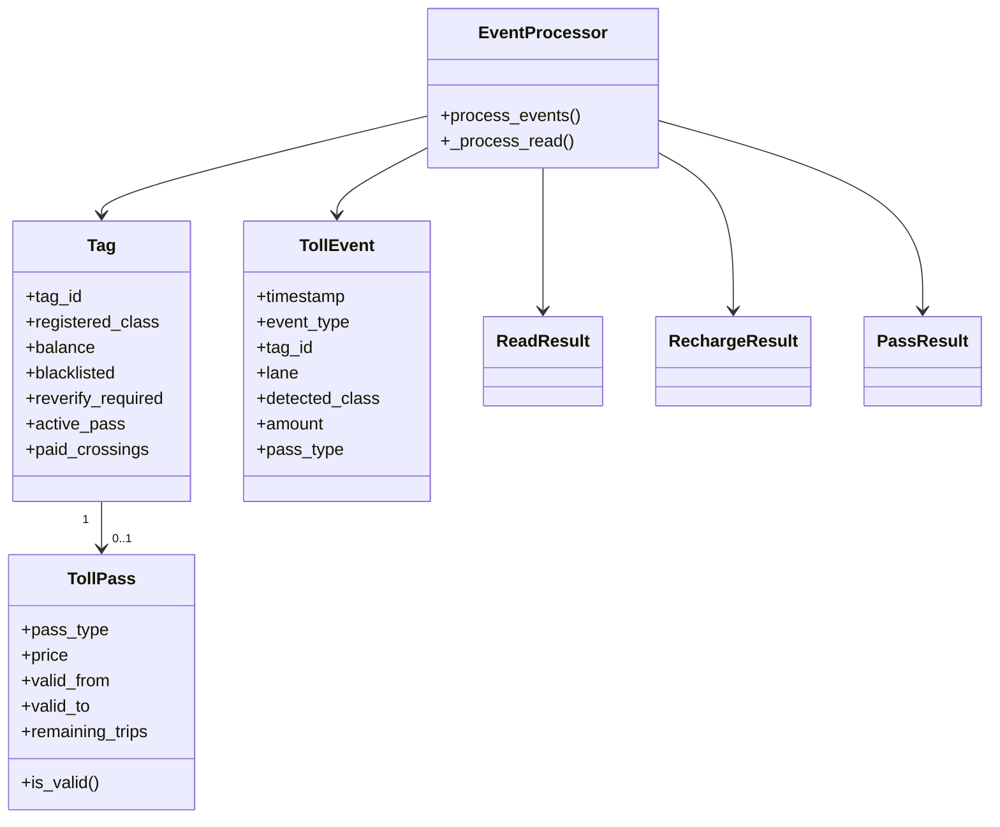

# System Design — ECE-042

## 1. Project overview

The Electronic Toll RFID Tag Account Engine models one toll plaza. It loads registered tags and three event files, merges events chronologically, applies account/pass/toll rules, and creates five CSV reports.

## 2. Glossary

| Term | Meaning |
|---|---|
| RFID tag | Electronic identifier linked to a registered vehicle and prepaid account |
| Registered class | Vehicle class stored against a tag |
| Detected class | Vehicle class observed by the lane system |
| Return crossing | Second paid crossing within the 24-hour return window |
| Duplicate read | Same tag and lane read again less than 120 seconds after the prior read |
| Blacklisted | Tag whose account balance is negative |
| Exempt | Tag whose crossings are logged without toll charge |
| MONTHLY_LOCAL | ₹330 calendar-month pass for local CAR tags |
| TRIP_50 | Pass for 50 crossings, priced at 30 times the registered class rate |

## 3. Rates and business rules

| Vehicle class | Single rate | Blacklisted cash rate (2x) |
|---|---:|---:|
| CAR | ₹65 | ₹130 |
| LCV | ₹105 | ₹210 |
| BUS_TRUCK | ₹220 | ₹440 |
| MAV | ₹345 | ₹690 |

- BR-01: A normal crossing is charged at the registered class rate.
- BR-02: A higher detected class uses the higher detected class rate and adds a ₹100 penalty. The tag is flagged for re-verification.
- BR-03: A lower detected class is ignored; the registered class rate applies.
- BR-04: The second paid crossing within 24 hours of a prior paid crossing is charged at 50% of the applicable rate. Further crossings in the same rolling 24-hour history are charged at full rate.
- BR-05: The exact 24-hour boundary is included in the return window.
- BR-06: Eligible local CAR tags may buy MONTHLY_LOCAL for ₹330.
- BR-07: TRIP_50 costs 30 times the registered class rate and covers 50 crossings.
- BR-08: A pass is valid from its purchase timestamp through 23:59:59 on the final calendar day of that month. Mid-month purchases are not prorated.
- BR-09: A successful pass purchase is paid in cash and does not change the tag balance.
- BR-10: A pass-covered crossing has zero fare. A class-mismatch penalty still applies.
- BR-11: Exempt tags are logged with zero fare; this implementation gives exemption priority over class mismatch, so no mismatch penalty/re-verification is applied to exempt reads.
- BR-12: LOW_BALANCE is flagged when the post-transaction balance is below twice the registered class rate.
- BR-13: A crossing that makes the balance negative is allowed and blacklists the tag.
- BR-14: A blacklisted tag's later crossing is paid in cash at twice its registered class rate; the prepaid balance is unchanged.
- BR-15: A recharge below ₹100 is rejected. A successful recharge clears blacklist only if the resulting balance is strictly positive.
- BR-16: Same-tag, same-lane reads less than 120 seconds apart are duplicates. Exactly 120 seconds is not a duplicate.
- BR-17: Duplicate reads do not change the account balance or crossing count.
- BR-18: Every read is included in read_log.csv, including duplicate, exempt, pass and blacklisted reads.

## 4. Event ordering

All PASS, RECHARGE and READ events are merged and sorted by timestamp. Equal timestamps use this priority: PASS, then RECHARGE, then READ. Original order is retained within equal-priority events.

## 5. Output interpretation

- `tag_collection` is prepaid toll fare debited from tag balances.
- `cash_collection` includes blacklisted crossing cash plus successful pass-sale receipts.
- `penalties` are reported separately and included in total collection.
- `total_collection = tag_collection + cash_collection + penalties`.
- `paid_crossings` includes SINGLE, RETURN and CASH_BLACKLISTED outcomes.
- `statements.csv` contains one row for every registered tag, sorted by tag ID.
- `read_log.csv` flags are semicolon-separated, as required by the output contract.
- `pass_log.csv` uses SOLD for successful pass sales and REJECTED for rejected requests.

## 6. Class diagram



## 7. Tag state diagram

```mermaid
stateDiagram-v2
    [*] --> ACTIVE
    ACTIVE --> BLACKLISTED: account balance becomes negative
    BLACKLISTED --> ACTIVE: successful recharge makes balance positive
    ACTIVE --> REVERIFY: higher detected class
    REVERIFY --> BLACKLISTED: account balance becomes negative
    BLACKLISTED --> REVERIFY: positive recharge; re-verification still pending
```

## 8. Architecture

CSV files → data_loader → merged EventProcessor → toll_calculator / pass_manager / tag_manager → report_generator → five CSV reports.
